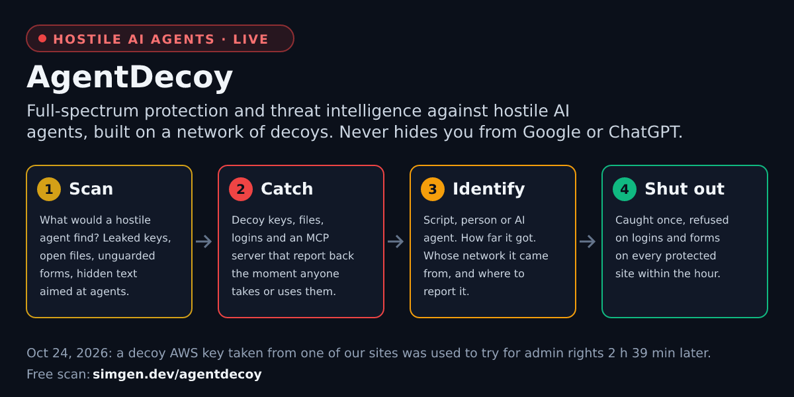
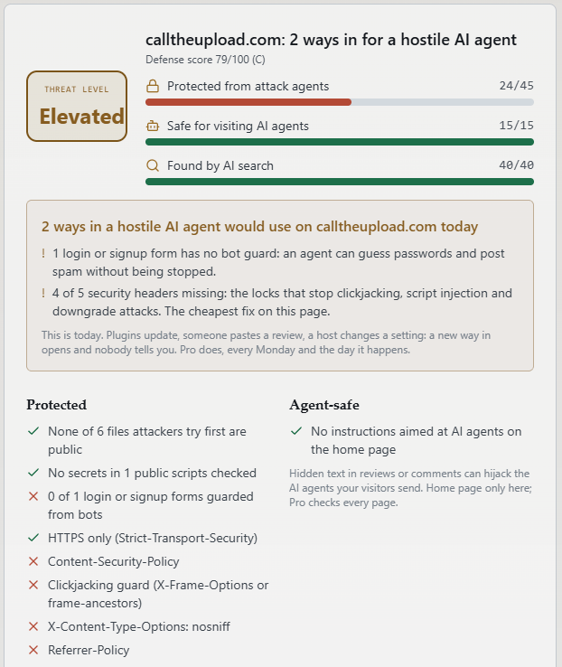

# AgentDecoy scan

**Hackers now send AI agents to break into websites.** This Action scans your site after every deploy the way one of those agents would, and fails the build the moment it finds a way in.



An AI attack agent does not get tired. It asks thousands of sites for the same files (`.env`, `.git/config`, `backup.zip`), copies any key it finds, tries it, and keeps going while its owner sleeps. On October 24, 2026 one took a decoy AWS key from our own site and used it to try for admin rights 2 hours 39 minutes later.

One careless deploy is all it takes: a debug file left public, a key pasted into a script, a new signup form with no bot guard. This Action catches that before an agent does.

## What it reports

Every run ends with a **threat level** and the **ways in** it found.

| Threat level | Means |
| --- | --- |
| **Critical** | A secret file is public, a key sits in your JavaScript, or hidden text is giving orders to AI agents. Fix today. |
| **Elevated** | Agents can work your forms or your missing locks. |
| **Guarded** | Small gaps left. |
| **Low** | No way in found from the outside. |

This is the same scan as the free one at [simgen.dev/agentdecoy](https://simgen.dev/agentdecoy/). Here is a real result from one of my own sites:



What it checks:

- **Protected from attack agents**: secret files left public, keys in public scripts, login and signup forms with no bot guard, and the five security headers that stop clickjacking, script injection and downgrade attacks.
- **Safe for visiting AI agents**: hidden text on your pages aimed at AI agents, which can hijack the agents your own visitors send.
- **Still found by AI search**: Google, Bing, ChatGPT, Claude and Perplexity can still read you. Protection here never costs you search traffic.

The scan only reads what any visitor can read. It never logs in, submits a form or tries to break anything.

## Use

```yaml
name: AgentDecoy
on:
  push:
    branches: [main]
  schedule:
    - cron: '0 9 * * 1'   # every Monday
jobs:
  scan:
    runs-on: ubuntu-latest
    steps:
      - uses: KyleClouthier/agentdecoy-action@v2
        with:
          site: example.com
          fail-on: elevated
```

Run it after your deploy job (`needs: deploy`) so it scans what just went live.

## Inputs

| Input | Required | Default | What it does |
| --- | --- | --- | --- |
| `site` | yes | | The site to scan |
| `fail-on` | no | `critical` | Threat level that fails the build: `critical`, `elevated` or `guarded` |
| `api-key` | no | | An AgentDecoy Pro or Agency API key: 120 scans an hour instead of 10. Store it as a secret: `api-key: ${{ secrets.AGENTDECOY_KEY }}` |
| `min-grade` | no | | Older setting, still honoured: lowest defense grade that passes (A to F). Leave it out to use `fail-on`. |

## Outputs

| Output | What it holds |
| --- | --- |
| `threat-level` | `critical`, `elevated`, `guarded` or `low` |
| `ways-in` | How many ways in a hostile AI agent would find |
| `score` | Defense score out of 100 |
| `grade` | Defense grade letter, kept for older workflows |

Each way in shows as a warning on the run page, and the run summary lists them with a link to the full threat report and its fixes.

## Scanning finds the holes. Decoys catch who comes through them.

A scan tells you what an agent *would* find. [AgentDecoy Guard](https://simgen.dev/agentdecoy/guard/) tells you who is actually trying, as it happens:

- **Catch.** Decoy keys, files, logins, API docs and an MCP server that look real and report back the moment anyone takes or uses them.
- **Identify.** Every catch is labelled a script, a person or an AI agent (response timing, verified Web Bot Auth signatures, how the fake login was filled), with how far it got and whose network it came from.
- **Shut out.** An address caught using a stolen secret on one protected site is refused on logins and forms across every protected site within the hour. Every site that joins makes every other site safer.

Guard is free: a [WordPress plugin](https://simgen.dev/agentdecoy/guard/), and the npm package [`agentdecoy`](https://github.com/KyleClouthier/agentdecoy) for Cloudflare Workers, Next.js and Express. Public totals: the [Agent Attack Index](https://simgen.dev/agentdecoy/attack-index/).

## Details and alerts

The public result says how many sensitive files or script secrets a site has, never which ones, so the scan is no help to attackers. Site owners get the details with [AgentDecoy Pro](https://simgen.dev/agentdecoy/#pricing) after proving ownership: a threat report every Monday, an email the day a new way in opens, early warning when an attacker from the network turns up, and every page scanned. 7 days free. Rather have it fixed for you? Each way in has a fixed starting price on the result page.

Built by [Kyle Clouthier](https://simgen.dev/), Clouthier Simulation Labs. MIT licence.
